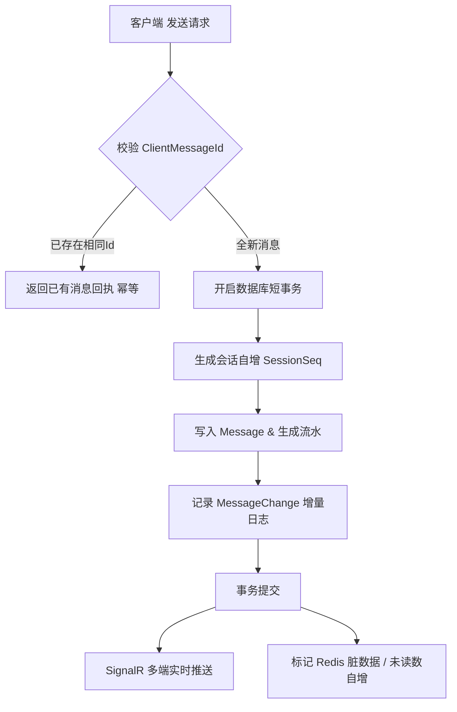

# IczpNet.Chat

[](https://dotnet.microsoft.com/)
[](https://abp.io/)
[](https://learn.microsoft.com/ef/core/)
[](https://learn.microsoft.com/aspnet/core/signalr/)
[](LICENSE)

`IczpNet.Chat` 是一套基于 **.NET 10** 与 **ABP vNext 10.6.1** 框架构建的企业级分布式即时通讯（IM）核心业务模块。系统采用领域驱动设计（DDD）规范与模块化架构，专为高并发、大数据量及多端协同（Flutter 移动端/桌面端、Electron 桌面端、Web 端、小程序）量身打造，提供高可用、多租户、安全合规的全功能即时通讯能力。

---

## 目录

- [核心架构与设计特性](#核心架构与设计特性)
- [项目结构与模块划分](#项目结构与模块划分)
- [技术栈](#技术栈)
- [聊天对象模型与交互矩阵](#聊天对象模型与交互矩阵)
- [快速开始](#快速开始)
  - [环境准备](#环境准备)
  - [使用 Docker Compose 快速运行](#使用-docker-compose-快速运行)
  - [本地开发调试](#本地开发调试)
- [核心机制说明](#核心机制说明)
  - [消息流水线与幂等机制](#消息流水线与幂等机制)
  - [多端在线状态与连接池](#多端在线状态与连接池)
  - [增量同步与断线重连](#增量同步与断线重连)
  - [AI 助理与异步调度](#ai-助理与异步调度)
- [功能路线图 (Roadmap)](#功能路线图-roadmap)
- [开发规范与注意事项](#开发规范与注意事项)

---

## 核心架构与设计特性

1. **统一聊天对象模型 (ChatObject)**
   - 抽象出统一的“聊天参与者”基座，涵盖：个人用户/员工 (`Person`)、外部客户 (`Customer`)、群聊 (`Room`)、聊天广场 (`Square`)、官方服务号 (`Official`)、订阅号 (`Subscription`)、电商掌柜 (`Shopkeeper`)、店小二 (`ShopWaiter`)、智能机器人 (`Robot`)。
   - 支持单用户多重身份绑定与动态角色切换。

2. **会话与会话单元架构 (Session & SessionUnit)**
   - 会话 (`Session`) 与独立用户的会话单元 (`SessionUnit`) 严格解耦。
   - **独立角标体系**：支持公共消息角标 (`PublicBadge`)、私有角标 (`PrivateBadge`)、特别关注角标与 `@我` 计数独立计算。
   - **个性化会话配置**：消息免打扰、置顶、自定义聊天背景、入群历史消息可视范围、会话内角色与细粒度权限控制。

3. **高吞吐与消息可靠性 (Message & SessionSeq)**
   - **幂等发信**：基于 `ClientMessageId` 强幂等设计，杜绝网络重试引发的重复入库。
   - **连续会话序号**：基于会话维度自增连续序号 (`SessionSeq`)，保障群内/单聊中消息严格保序与漏包检测。
   - **复合消息类型**：内置文本、富文本/Markdown、图片、语音、视频、文件、地理位置、名片、红包、系统指令通知等全格式支持。
   - **状态与轨迹**：细粒度记录消息已读 (`ReadedRecorder`)、打开轨迹 (`OpenedRecorder`)、软删除与会话可见性过滤 (`DeletedRecorder`)。

4. **本地优先与增量同步 (Local-First Sync)**
   - 服务端提供全局 `MessageChange` 增量变更流水，配合会话游标快速拉取增量数据。
   - 为桌面端（Electron）及移动端（Flutter）本地 SQLite 离线缓存、高水位标记重连补偿提供坚实的服务端契约支持。

5. **多端在线连接池 (ConnectionPools)**
   - 支持 PC、手机、平板、网页端多设备同时在线与互斥踢出。
   - 基于 Redis `ListSet` 分布式索引，快速判定在线状态与具体设备类型。
   - 自动广播好友上下线事件与设备变更状态。

6. **AI 大模型对话与后台异步分发 (AI Providers & BackgroundWorker)**
   - 具备插件式 AI 智能体接入能力（ChatGPT、Google Gemini 等），支持对话驱动。
   - 独立的 `BackgroundWorker` 负责会话未读计数回写、Redis 脏标记刷新以及异步 AI 任务调度。

---

## 项目结构与模块划分

```text
IczpNet.Chat/
├── src/                                   # 核心类库模块 (DDD 分层)
│   ├── IczpNet.Chat.Domain.Shared/        # 枚举、常量、错误码、国际化资源
│   ├── IczpNet.Chat.Domain/               # 实体、聚合根、领域服务、仓储接口、领域事件
│   ├── IczpNet.Chat.Application.Contracts/# 应用服务接口、输入输出 DTO、权限契约
│   ├── IczpNet.Chat.Application/          # 核心业务编排、用例逻辑、事务协调
│   ├── IczpNet.Chat.Admin.Application/    # 平台运营与后台管理应用服务
│   ├── IczpNet.Chat.ManagementApplication/# 租户/群组管理应用服务
│   ├── IczpNet.Chat.HttpApi/              # ASP.NET Core REST API 控制器端点
│   ├── IczpNet.Chat.HttpApi.Client/       # C# 强类型客户端 SDK (基于 Refit/HttpClient)
│   ├── IczpNet.Chat.EntityFrameworkCore/  # EF Core 映射、SQL Server 仓储实现与查询优化
│   ├── IczpNet.Chat.EntityFrameworkCore.DbMigrations/ # 独立数据迁移管理
│   ├── IczpNet.Chat.MongoDB/              # MongoDB 数据适配（预留）
│   └── IczpNet.Chat.Installer/            # ABP 模块安装包打包支持
│
├── host/                                  # 宿主项目
│   ├── IczpNet.Chat.HttpApi.Host/         # Web API 服务端主入口、SignalR Hub 宿主
│   ├── IczpNet.Chat.BackgroundWorker/     # 独立后台处理服务（定时任务、Redis刷新、AI分发）
│   ├── IczpNet.Chat.AuthServer/           # 认证授权服务 (OpenIddict)
│   ├── IczpNet.Chat.AiProviders/          # AI 大语言模型提供商对接
│   ├── IczpNet.Chat.SchemaMigrator/       # 数据库迁移执行器
│   └── IczpNet.Chat.Host.Shared/          # Host 公共配置与扩展
│
├── test/                                  # 单元测试与集成测试
│   ├── IczpNet.Chat.Domain.Tests/         # 领域逻辑、Mapperly 映射、并发与幂等测试
│   ├── IczpNet.Chat.EntityFrameworkCore.Tests/ # EF Core 集成与仓储测试
│   └── IczpNet.Chat.TestBase/             # 测试基础设施与数据种子
│
├── docs/                                  # 架构文档、设计规约、日志与迁移指南
├── docker-compose.yml                     # 容器编排文件 (SQL Server + Redis + MinIO + API + Worker)
└── common.props                           # MSBuild 全局编译配置
```

---

## 技术栈

| 维度 | 技术栈 / 依赖项 | 描述 |
| :--- | :--- | :--- |
| **运行时** | .NET 10.0 / C# 13 | 极致性能与现代 C# 特性支持 |
| **应用框架** | ABP Framework 10.6.1 | DDD 分层、模块化体系、依赖注入、事件总线 |
| **ORM & 数据库** | EF Core 10.0 + SQL Server 2022 | 复杂查询、游标索引优化、短事务保障 |
| **缓存与原子状态** | Redis 6+ / StackExchange.Redis | 分布式连接池、脏标记集中收集、原子计数自增 |
| **实时通讯** | ASP.NET Core SignalR | 全双工多路复用连接、事件广播、会话推送 |
| **对象映射** | Riok.Mapperly | 高性能编译期 Source Generator 映射，零运行时反射损耗 |
| **对象存储** | MinIO / Volo.Abp.BlobStoring | 附件、图片、音视频文件存储及安全签名下载机制 |
| **安全与认证** | OpenIddict / OAuth2 / JWT | 集中认证、凭证校验、资源授权 |

---

## 聊天对象模型与交互矩阵

系统中的每种会话形态均通过 `ChatObject` 进行定义与约束：

| 聊天对象类型 | 英文标识 | 典型场景 | 单聊模式 | 群聊模式 | 订阅/通知模式 |
| :--- | :--- | :--- | :---: | :---: | :---: |
| **个人 (用户/员工)** | `Person` | 普通用户、内部企业员工 | ✅ 支持 | ✅ 可作为群成员 | ❌ |
| **客户** | `Customer` | 外部访客、电商客户 | ✅ 客服单聊 | ❌ | ❌ |
| **群聊** | `Room` | 多人交流群、项目协作组 | ❌ | ✅ 多人交互 | ❌ |
| **聊天广场** | `Square` | 全体/公开频道的开放式讨论区 | ❌ | ✅ 开放群聊 | ❌ |
| **官方号** | `Official` | 系统通知、功能动态、业务工单推送 | ✅ 单向通知 | ❌ | ✅ 服务通知 |
| **订阅号** | `Subscription` | 新闻资讯、公告文章广播 | ❌ | ❌ | ✅ 广播订阅 |
| **电商掌柜** | `Shopkeeper` | 旗舰店总管账号 | ✅ 对接买家 | ✅ 店铺群 | ❌ |
| **店小二** | `ShopWaiter` | 坐席客服、售后专员（子账号） | ✅ 客服接待 | ✅ 店铺群 | ❌ |
| **智能机器人** | `Robot` | 智能助理、入群欢迎、自动化告警 | ✅ 问答互动 | ✅ 群助手 | ❌ |

---

## 快速开始

### 环境准备

- **操作系统**：Windows / macOS / Linux
- **开发工具**：Visual Studio 2022 (最新版) 或 VS Code / JetBrains Rider
- **SDK**：[.NET 10 SDK](https://dotnet.microsoft.com/download)
- **容器环境**：Docker & Docker Compose

### 使用 Docker Compose 快速运行

仓库根目录内置了完整的 `docker-compose.yml`，包含 SQL Server 2022、Redis、MinIO、API Host 与 BackgroundWorker：

1. **配置环境变量**：
   ```bash
   cp .env.example .env
   # 根据实际需求修改 .env 中的密码与端口设置（如 SQL_SA_PASSWORD、REDIS_PASSWORD 等）
   ```

2. **启动基础支撑组件与应用服务**：
   ```bash
   docker compose up -d
   ```

3. **服务端口一览**：
   - **Chat API Host**：`http://localhost:51601`（包含 Swagger 文档 UI）
   - **SQL Server**：`localhost:14333`
   - **Redis**：`localhost:6379`
   - **MinIO Console**：`http://localhost:19001` (API 端口: `9000`)

### 本地开发调试

1. **还原依赖并构建解决方案**：
   ```bash
   dotnet restore IczpNet.Chat.sln
   dotnet build IczpNet.Chat.sln
   ```

2. **配置连接字符串**：
   在 `host/IczpNet.Chat.HttpApi.Host/appsettings.json` 中配置本地数据库与 Redis 连接：
   ```json
   {
     "ConnectionStrings": {
       "Default": "Server=127.0.0.1,14333;Initial Catalog=Chat_Main;User ID=sa;Password=YourPassword;Encrypt=False;TrustServerCertificate=True",
       "Chat": "Server=127.0.0.1,14333;Initial Catalog=Chat_Module_v3;User ID=sa;Password=YourPassword;Encrypt=False;TrustServerCertificate=True"
     },
     "Redis": {
       "Configuration": "127.0.0.1:6379,password=YourPassword"
     }
   }
   ```

3. **执行数据库迁移**：
   运行 `IczpNet.Chat.SchemaMigrator` 工具完成数据库表结构和种子数据初始化：
   ```bash
   dotnet run --project host/IczpNet.Chat.SchemaMigrator
   ```

4. **启动 API 服务**：
   ```bash
   dotnet run --project host/IczpNet.Chat.HttpApi.Host
   ```
   启动后访问 `http://localhost:51601/swagger` 即可查看完整的 REST API 调试界面。

5. **启动后台 Worker 调度**：
   ```bash
   dotnet run --project host/IczpNet.Chat.BackgroundWorker
   ```

6. **运行自动化测试**：
   ```bash
   dotnet test test/IczpNet.Chat.Domain.Tests/IczpNet.Chat.Domain.Tests.csproj
   ```

---

## 核心机制说明

### 消息流水线与幂等机制



- **原子发信**：消息写入、`SessionSeq` 分配与变更日志在单一短事务内提交，保证严格的数据一致性。
- **防止重复入库**：对于因弱网重试带来的重复请求，利用唯一的 `ClientMessageId` 与时间窗口直接响应原始回执。

### 多端在线状态与连接池

- 连接池核心接口：`IConnectionPoolManager`
- 客户端建立 SignalR 连接后注册连接节点，记录当前登录账号、`ChatObjectId`、客户端类型（`PC` / `Mobile` / `Tablet` / `Web`）。
- 服务端统一通过 Redis 维护心跳与活跃时间戳，支持管理员或用户在其他设备上一键剔除会话。

### 增量同步与断线重连

- 服务端为每个会话单元维护 `LastMessageId`、`ReadMessageId` 与增量事件流水。
- 客户端在断线重连后无需拉取全量历史，只需通过 `GetMessageChangesAsync(afterSeq)` 按游标补偿漏收的变更，保证离线消息零丢失、高吞吐。

### AI 助理与异步调度

- `IczpNet.Chat.AiProviders` 提供大模型推理驱动。
- 当群聊中 `@机器人` 或发起对话时，系统异步提交推理作业至任务队列，由 `BackgroundWorker` 统一拉取并流式推送生成内容，避免阻塞主业务 API。

---

## 功能路线图 (Roadmap)

### 聊天对象体系 (ChatObject)
- [x] 单用户绑定多个聊天对象与身份切换
- [x] 智能机器人 (Robot)
- [x] 官方号与服务号 (Official / Subscription)
- [x] 电商掌柜与店小二 (Shopkeeper / ShopWaiter)
- [x] 聊天广场 (Square)
- [x] 匿名会话支持 (Anonymous)
- [x] 动态属性扩展（手机号、职位、工号、业务标识等）
- [x] 个性签名与用户状态
- [ ] 朋友圈 / 动态圈子功能

### 会话与群聊体系 (Session & Room)
- [x] 单聊与群聊完整功能
- [x] 细粒度群角色配置与群成员权限
- [x] 好友验证与入群审核流转
- [x] 邀请加群与群主转让
- [x] 群内组织架构与分组
- [x] 新成员历史消息查看范围控制
- [x] 会话置顶、免打扰与自定义聊天背景
- [x] 独立会话角标统计（新消息、特别关注、@我、私有消息）
- [x] 消息收藏夹
- [ ] 面对面建群与二维码扫码加入
- [ ] 群内禁言（全员禁言 / 指定成员禁言）
- [ ] 群公告与置顶消息

### 消息能力 (Messages)
- [x] 基础消息类型（文本、Markdown、图片、语音、视频、文件、位置）
- [x] 名片消息、链接卡片消息、历史合并转发
- [x] 红包消息格式规范
- [x] 消息引用与回复
- [x] 消息已读回执 (`ReadedRecorder`) 与打开追踪 (`OpenedRecorder`)
- [x] 客户端全局消息撤回与本地单向删除 (`DeletedRecorder`)
- [x] 系统通知与控制指令消息 (Command)
- [ ] 敏感词过滤与合规审计
- [ ] 基于 Elasticsearch 的海量全文消息搜索

### 电商与客服体系 (Customer Service)
- [x] 掌柜与店小二子账号绑定与管理
- [x] 客服会话多端同步
- [x] 会话转接与跨坐席流转
- [ ] 智能排队与负载均衡分流
- [ ] 客服坐席状态流转（在线、忙碌、挂起、小休）

### 开放能力与生态 (Open Ecosystem)
- [x] 开发者参数设置 (Token、EncodingAesKey、CallbackUrl)
- [x] 签名校验与事件推送机制
- [x] 后台重试作业保证可靠投递
- [x] 完整 Swagger / OpenAPI 规范
- [ ] WebHook 与 API Key 访问令牌管理
- [ ] 开箱即用的第三方 SDK (C#, TypeScript, Dart)

---

## 开发规范与注意事项

> ⚠️ **重要开发守则**（详见项目根目录 [`AGENTS.md`](AGENTS.md)）：
>
> 1. **严禁破坏分层架构**：业务领域规则严禁写入 Controller，基础设施与 EF 特有 API 严禁泄漏到 Domain 核心层。
> 2. **大数据量与高并发设计**：杜绝全表扫描与大 Offset 分页，查询历史消息必须采用基于 `MessageId` / `SessionSeq` 的游标分页（Cursor Pagination）。
> 3. **Redis 原子性与一致性**：涉及计数、角标、游标时必须使用 Redis 原子命令（如 `INCR`、`HINCRBY`、Lua 脚本），杜绝 `GET -> 修改 -> SET` 竞态。
> 4. **数据库变更安全**：实体修改必须通过严格的 Migration 流程核验，严禁在生产启动时随意删除或重构核心字段。

---

## 许可证 (License)

本项目采用 [MIT License](LICENSE) 授权许可。
