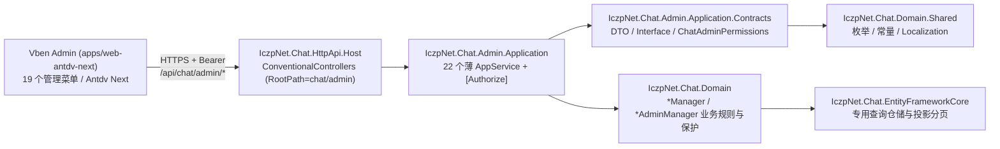

# ChatAdmin 管理端交付与架构总览手册

> 本文档为 `IczpNet.Chat` 管理端（`ChatAdmin`）与 `abp-admin-vben`（`apps/web-antdv-next`）的完整交付手册，汇总了分层架构、全部 `/api/chat/admin/...` 自动 API 契约、ABP 权限矩阵、19 个 Vben 管理端菜单映射、安全护栏、自动化测试验收及后续扩展规范。

---

## 1. 总体架构与分层边界

ChatAdmin 严格遵循 **ABP vNext 模块化分层 + Domain 业务收敛 + ConventionalControllers 自动路由 + Vben 独立管理入口** 原则：
- **禁止手写 Admin Controller**，禁止复用或回退至旧版 `/api/chat/...` 客户端接口；
- **禁止修改服务端数据库表结构或自动生成迁移**；
- **所有业务查询、分页投影、状态变更与安全校验**统一收敛至 `IczpNet.Chat.Domain` 与 `IczpNet.Chat.EntityFrameworkCore`。

### 1.1 关键工程约束

1. **`[ExposeServices]` 命名约定**：由于管理端 AppService 类名采用 `<Entity>AppService`（使 ABP ConventionalControllers 自动映射为 `/api/chat/admin/<kebab-entity>`），而接口命名为 `I<Entity>AdminAppService`，每个服务类均显式标注 `[ExposeServices(typeof(<Class>), typeof(I<Entity>AdminAppService))]` 以确保依赖注入正常解析。
2. **大 ID 精度保护**：跨 JS/JSON 传输的 `long` 主键（如 `Message.Id`、`ChatObject.Id`、`OwnerId`）在 Vben 端通过 `parseArticleResponse` 或后端 `JsonNumberHandling` 保持精度，避免浏览器双精度浮点舍入。
3. **内置资源保护**：静态聊天对象（`IsStatic`）、系统固有类型、运行中 AI 任务（`AiRunStatus.Running`）、引用计数大于 0 的附件（`Blob.RefCount > 0`）、存在子节点或在用引用的分类树节点均在 Domain 层设置拦截保护。

---

## 2. 全量 `/api/chat/admin/...` 接口契约清单

`IczpNet.Chat.HttpApi.Host` 通过 `ConventionalControllers.Create(typeof(ChatAdminApplicationModule).Assembly, ...)` 自动暴露以下 22 个管理服务（远程服务名 `ChatAdmin`，路由前缀 `/api/chat/admin`）：

| 序号 | 模块 | AppService | 基础路由前缀 | 核心端点 | Domain 入口 |
| --- | --- | --- | --- | --- | --- |
| 1 | 运营总览 | `OverviewAppService` | `/api/chat/admin/overview` | `GET /summary` | `IOverviewAdminManager` |
| 2 | 聊天对象 | `ChatObjectAppService` | `/api/chat/admin/chat-object` | `GET /`、`GET /{id}`、`POST /`、`PUT /{id}`、`DELETE /{id}`、`POST /{id}/set-verification-method`、`POST /{id}/set-is-enabled` | `IChatObjectManager` / `IChatObjectRepository` |
| 3 | 对象分类 | `ChatObjectCategoryAppService` | `/api/chat/admin/chat-object-category` | `GET /`、`GET /tree`、`GET /{id}`、`POST /`、`PUT /{id}`、`DELETE /{id}` | `IChatObjectCategoryManager` |
| 4 | 对象类型 | `ChatObjectTypeAppService` | `/api/chat/admin/chat-object-type` | `GET /`、`GET /{id}`、`POST /`、`PUT /{id}`、`DELETE /{id}` | `IChatObjectTypeManager` |
| 5 | 字典字段 | `EntryNameAppService` | `/api/chat/admin/entry-name` | `GET /`、`GET /tree`、`GET /{id}`、`POST /`、`PUT /{id}`、`DELETE /{id}` | `IEntryNameManager` |
| 6 | 字典选项 | `EntryValueAppService` | `/api/chat/admin/entry-value` | `GET /`、`GET /{id}`、`POST /`、`PUT /{id}`、`DELETE /{id}` | `IEntryValueManager` |
| 7 | 邀请码 | `InvitationCodeAppService` | `/api/chat/admin/invitation-code` | `GET /`、`GET /{id}`、`POST /`、`PUT /{id}`、`DELETE /{id}`、`POST /{id}/set-is-enabled` | `IInvitationCodeManager` |
| 8 | URL 风控规则 | `UrlSecurityRuleAppService` | `/api/chat/admin/url-security-rule` | `GET /`、`GET /{id}`、`POST /`、`PUT /{id}`、`DELETE /{id}`、`POST /{id}/set-enabled`、`POST /refresh-cache`、`POST /check-url` | `IUrlSecurityAdminManager` |
| 9 | 违规举报工单 | `SecurityReportAppService` | `/api/chat/admin/security-report` | `GET /`、`GET /{id}`、`POST /{id}/handle` | `IUrlSecurityAdminManager` |
| 10 | AI 任务记录 | `AiRunAppService` | `/api/chat/admin/ai-run` | `GET /`、`GET /{id}`、`GET /by-source-message-id/{sourceMessageId}`、`GET /by-session/{sessionId}`、`POST /`、`POST /{id}/retry`、`POST /{id}/cancel`、`DELETE /{id}`、`DELETE /many` | `IAiRunManager` |
| 11 | 对象存储 Blob | `BlobAppService` | `/api/chat/admin/blob` | `GET /`、`GET /{id}`、`GET /many`、`PUT /{id}`、`DELETE /{id}` | `IBlobManager` |
| 12 | 扫码流水 | `ScanCodeAppService` | `/api/chat/admin/scan-code` | `GET /`、`GET /{id}`、`POST /scan` | `IScanCodeManager` |
| 13 | 消息报表 | `MessageReportAppService` | `/api/chat/admin/message-report` | `GET /`、`GET /summary`、`GET /options`、`POST /flush` | `IMessageReportAdminManager` |
| 14 | 在线连接池 | `OnlineAppService` | `/api/chat/admin/online` | `GET /`、`GET /{id}`、`GET /total-count`、`GET /hosts`、`GET /by-user/{userId}`、`GET /by-owner/{ownerId}`、`GET /count-by-user/{userId}`、`GET /count-by-owner/{ownerId}`、`GET /count-by-session/{sessionId}`、`GET /last-online/{ownerId}`、`GET /online-friends-count/{ownerId}`、`POST /abort`、`DELETE /`、`POST /clear-all` | `IOnlineManager` / `IAbortService` |
| 15 | 自定义模板消息 | `MessageTemplateAppService` | `/api/chat/admin/message-template` | `GET /`、`GET /{id}`、`POST /`、`PUT /{id}`、`POST /{id}/publish`、`POST /{id}/set-enabled`、`GET /{id}/revisions`、`GET /{id}/revision`、`POST /preview` | `IMessageTemplateAdminManager` |
| 16 | 文章定时调度 | `ArticleMessageScheduleAppService` | `/api/chat/admin/article-message-schedule` | `GET /`、`POST /`、`POST /{id}/reschedule`、`POST /{id}/cancel`、`POST /{id}/execute-now` | `IArticleScheduleAdminManager` |
| 17 | 会话单元查询 | `SessionUnitAppService` | `/api/chat/admin/session-unit` | `GET /`、`GET /{id}`、`POST /find-id` | `ISessionUnitAdminManager` |
| 18 | 管理端消息服务 | `MessageAppService` | `/api/chat/admin/message` | `GET /`、`GET /{id}`、`GET /history`、`POST /send-article-content-message/{sessionUnitId}`、`POST /send-template-content-message/{sessionUnitId}`、`POST /rollback/{messageId}` | `IMessageAdminManager` |
| 19 | 会话档案 | `SessionAppService` | `/api/chat/admin/session` | `GET /`、`GET /{id}`、`POST /{id}/set-is-enabled` | `ISessionAdminManager` |
| 20 | 入群与好友申请 | `SessionRequestAppService` | `/api/chat/admin/session-request` | `GET /`、`GET /{id}` | `ISessionRequestAdminManager` |
| 21 | 群角色管理 | `SessionRoleAppService` | `/api/chat/admin/session-role` | `GET /`、`GET /{id}` | `ISessionRoleAdminManager` |
| 22 | 群公告管理 | `SessionAnnouncementAppService` | `/api/chat/admin/session-announcement` | `GET /`、`GET /{id}` | `ISessionAnnouncementAdminManager` |

---

## 3. `ChatAdmin` 权限树与本地化

权限组：`ChatAdmin`（定义于 [ChatAdminPermissions.cs](file:///f:/Dev/abpvnext/IczpNet.Chat/src/IczpNet.Chat.Admin.Application.Contracts/Permissions/ChatAdminPermissions.cs) 与 [ChatAdminPermissionDefinitionProvider.cs](file:///f:/Dev/abpvnext/IczpNet.Chat/src/IczpNet.Chat.Admin.Application.Contracts/Permissions/ChatAdminPermissionDefinitionProvider.cs)）。

| 权限分组前缀 | 子权限项 | 说明 |
| --- | --- | --- |
| `ChatAdmin.Overview` | `Default` | Chat 运营总览查看 |
| `ChatAdmin.ChatObjects` | `GetList` / `GetDetail` / `Create` / `Update` / `Delete` / `SetVerificationMethod` / `SetIsEnabled` | 聊天对象档案与状态管控 |
| `ChatAdmin.ChatObjectCategories` | `GetList` / `GetDetail` / `Create` / `Update` / `Delete` | 对象分类树管理 |
| `ChatAdmin.ChatObjectTypes` | `GetList` / `GetDetail` / `Create` / `Update` / `Delete` | 对象类型管理 |
| `ChatAdmin.EntryNames` | `GetList` / `GetDetail` / `Create` / `Update` / `Delete` | 动态属性字段树管理 |
| `ChatAdmin.EntryValues` | `GetList` / `GetDetail` / `Create` / `Update` / `Delete` | 动态属性选项值管理 |
| `ChatAdmin.InvitationCodes` | `GetList` / `GetDetail` / `Create` / `Update` / `Delete` / `SetIsEnabled` | 邀请码管理 |
| `ChatAdmin.UrlSecurityRules` | `GetList` / `GetDetail` / `Create` / `Update` / `Delete` / `SetEnabled` / `RefreshCache` / `CheckUrl` | URL 风控规则与缓存刷新 |
| `ChatAdmin.SecurityReports` | `GetList` / `GetDetail` / `Handle` | 违规举报审核处理 |
| `ChatAdmin.AiRuns` | `GetList` / `GetDetail` / `Retry` / `Cancel` / `Delete` | AI 任务状态监控、重试与取消 |
| `ChatAdmin.Blobs` | `GetList` / `GetDetail` / `Update` / `Delete` | 附件元数据维护与删除 |
| `ChatAdmin.ScanCodes` | `GetList` / `GetDetail` / `Simulate` | 扫码流水查询与模拟 |
| `ChatAdmin.MessageReports` | `GetList` / `GetSummary` / `GetOptions` / `Flush` | 消息报表统计与刷盘 |
| `ChatAdmin.Online` | `GetList` / `GetDetail` / `Abort` / `Delete` / `ClearAll` | 在线连接池诊断与强制下线 |
| `ChatAdmin.MessageTemplates` | `GetList` / `GetDetail` / `Create` / `Update` / `Publish` / `Share` / `Use` / `ManageAll` | 模板消息全生命周期与试发 |
| `ChatAdmin.ArticleMessages` | `Manage` / `Schedule` / `Send` / `Rollback` | 文章消息推送、调度与撤回 |
| `ChatAdmin.SessionUnits` | `GetList` / `GetDetail` | 会话单元查询 |
| `ChatAdmin.Messages` | `GetList` / `GetDetail` / `GetContent` / `Send` / `Rollback` | 消息档案检索、正文取证（独立授权）与撤回 |
| `ChatAdmin.Sessions` | `GetList` / `GetDetail` / `SetIsEnabled` | 会话档案与启停管控 |
| `ChatAdmin.SessionRequests` | `GetList` / `GetDetail` | 入群与好友申请记录查询 |
| `ChatAdmin.SessionRoles` | `GetList` / `GetDetail` | 群角色与权限统计查询 |
| `ChatAdmin.SessionAnnouncements` | `GetList` / `GetDetail` | 群公告发布与确认统计查询 |

---

## 4. Vben Admin 菜单、页面与 API 映射清单

Vben 路由模块位于 `apps/web-antdv-next/src/router/routes/modules/chat.ts`，共覆盖 **19** 个管理子页面：

| 菜单路由 (`/chat/...`) | 页面组件 (`src/views/chat/...`) | API 封装 (`src/api/chat/...`) | 路由权限 |
| --- | --- | --- | --- |
| `overview` | `overview/index.vue` | `overview.ts` | `ChatAdmin.Overview` |
| `session` | `session/index.vue` | `session.ts` | `ChatAdmin.Sessions` |
| `message` | `message/index.vue` | `message.ts` | `ChatAdmin.Messages` |
| `session-request` | `session-request/index.vue` | `session-request.ts` | `ChatAdmin.SessionRequests` |
| `session-role` | `session-role/index.vue` | `session-role.ts` | `ChatAdmin.SessionRoles` |
| `session-announcement` | `session-announcement/index.vue` | `session-announcement.ts` | `ChatAdmin.SessionAnnouncements` |
| `article-message` | `article-message/index.vue` | `article-message.ts` | `ChatAdmin.ArticleMessages.Manage` |
| `message-template` | `message-template/index.vue` | `message-template.ts` | `ChatAdmin.MessageTemplates` |
| `chat-object` | `chat-object/index.vue` | `chat-object.ts` | `ChatAdmin.ChatObjects` |
| `category-type` | `category-type/index.vue` | `category-type.ts` | `ChatAdmin.ChatObjectCategories` |
| `dictionary` | `dictionary/index.vue` | `dictionary.ts` | `ChatAdmin.EntryNames` |
| `online` | `online/index.vue` | `online.ts` | `ChatAdmin.Online` |
| `invitation-code` | `invitation-code/index.vue` | `invitation-code.ts` | `ChatAdmin.InvitationCodes` |
| `message-report` | `message-report/index.vue` | `message-report.ts` | `ChatAdmin.MessageReports` |
| `blob` | `blob/index.vue` | `blob.ts` | `ChatAdmin.Blobs` |
| `scan-code` | `scan-code/index.vue` | `scan-code.ts` | `ChatAdmin.ScanCodes` |
| `ai-run` | `ai-run/index.vue` | `ai-run.ts` | `ChatAdmin.AiRuns` |
| `url-security-rule` | `url-security-rule/index.vue` | `security.ts` | `ChatAdmin.UrlSecurityRules` |
| `security-report` | `security-report/index.vue` | `security.ts` | `ChatAdmin.SecurityReports` |

---

## 5. 自动化测试与构建验证记录

| 检查项 | 执行命令 | 最新结果 |
| --- | --- | --- |
| 管理端集成与路由测试 | `dotnet test "f:\Dev\abpvnext\IczpNet.Chat\test\IczpNet.Chat.Application.Tests\IczpNet.Chat.Application.Tests.csproj" --filter "FullyQualifiedName~IczpNet.Chat.Admin"` | **23 / 23 通过**（覆盖 6 个测试类：对象、分类类型、字典邀请码、风控AI附件、扫码报表在线、模板文章消息、总览会话角色公告） |
| ApiHost 编译 | `dotnet build "f:\Dev\abpvnext\IczpNet.Chat\host\IczpNet.Chat.HttpApi.Host\IczpNet.Chat.HttpApi.Host.csproj" --no-restore` | **0 警告，0 错误** |
| Vben 类型检查 | `pnpm --dir "f:\Dev\abpvnext\abp-admin-vben\vue-vben-admin\apps\web-antdv-next" run typecheck` | **通过（退出码 0）** |
| 遗留路由审计 | `Select-String` 检查 `src/api/chat/*.ts` | 零旧版 `/chat/...` 接口调用（仅保留头像图片资源 `/api/chat/avatar/get?chatObjectId=${id}`） |

---

## 6. 后续扩展指南（批次五专项业务）

如需继续扩充批次五专项能力（公众号菜单、聊天广场、机器人、客服坐席、开发者回调、钱包红包、客户端配置等），请按以下固定顺序推进：
1. 在 `IczpNet.Chat.Domain` 新增或扩展对应 `*Manager`（先盘点现有 Domain 能力并复用）；
2. 在 `IczpNet.Chat.Admin.Application.Contracts` 定义 `I*AdminAppService`、DTO 与 `ChatAdmin.*` 权限常量及本地化；
3. 在 `IczpNet.Chat.Admin.Application` 实现薄 `AppService`（标注 `[ExposeServices]` 与 `[Authorize]`），**严禁手写 Admin Controller**；
4. 在 `test/IczpNet.Chat.Application.Tests/Admin/` 补充 CRUD、业务护栏与 ConventionalControllers 路由断言；
5. 在 `apps/web-antdv-next` 新增 `src/api/chat/*.ts`、`src/views/chat/*/index.vue` 与路由注册，并执行 `vue-tsc` 校验。
